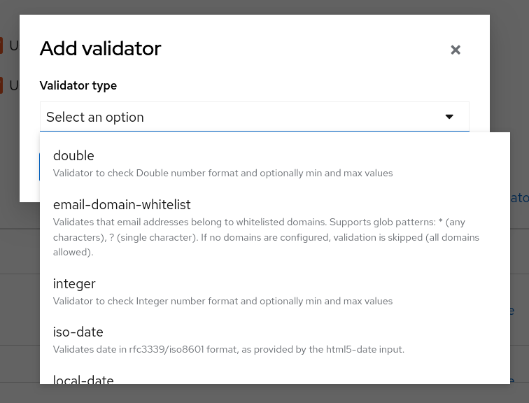
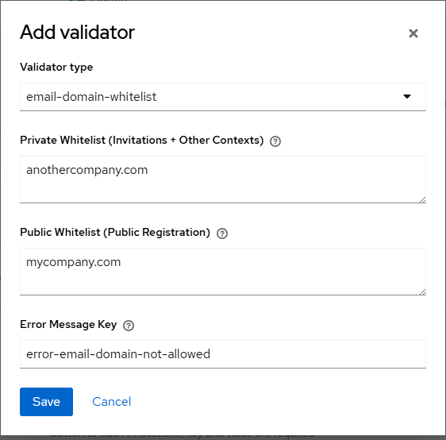

# Keycloak Email Domain Whitelist Validator

[](https://github.com/Tknika/keycloak-email-domain-validator/actions/workflows/ci.yml)
[](https://opensource.org/licenses/Apache-2.0)

A custom Keycloak UserProfile Validator that restricts email addresses to a configurable list of allowed domains. This validator applies to **ALL** email update contexts in Keycloak, including registration, UPDATE_EMAIL required action, profile updates, account console, and admin API operations.




This project has been inspired by the [keycloak-mail-whitelisting](https://github.com/micedre/keycloak-mail-whitelisting) project, which works great for the registration flow, but not for the UPDATE_EMAIL flow. This project is a UserProfile validator that applies to all email update contexts so it can be used in all contexts.

## Features

- ✅ Validates email domains across all Keycloak contexts
- ✅ Support for multiple allowed domains
- ✅ Glob pattern matching with `*` (any characters) and `?` (single character) wildcards
- ✅ Case-insensitive domain matching
- ✅ Internationalized error messages (English, Spanish, French, Basque)
- ✅ Easy configuration through Keycloak's User Profile UI
- ✅ Permissive mode when no domains are configured

## Requirements

- Keycloak 26.x or later (Jakarta EE)
- Java 17+
- Docker and Docker Compose (for building)

## Building the Project

This project uses Docker for all build operations to ensure a consistent development environment.

### Build the JAR

```bash
# Build the Docker image
docker compose build

# Build the project and create the JAR
docker compose run --rm maven clean package
```

The JAR will be available at `target/keycloak-email-domain-validator-1.0.0-SNAPSHOT.jar`

### Run Tests

```bash
# Run all unit tests
docker compose run --rm maven test

# Run tests with verbose output
docker compose run --rm maven test -X
```

### Other Maven Commands

```bash
# Clean the build
docker compose run --rm maven clean

# Verify the build
docker compose run --rm maven verify

# Install to local Maven repository
docker compose run --rm maven install
```

## Installation

### Keycloak Quarkus Distribution (26.x+)

1. Copy the JAR to the Keycloak providers directory:

```bash
cp target/keycloak-email-domain-validator-1.0.0-SNAPSHOT.jar $KEYCLOAK_HOME/providers/
```

2. Rebuild Keycloak to load the new provider:

```bash
$KEYCLOAK_HOME/bin/kc.sh build
```

3. Start Keycloak:

```bash
$KEYCLOAK_HOME/bin/kc.sh start
```

### Docker Deployment

Create a Dockerfile extending the official Keycloak image:

```dockerfile
FROM quay.io/keycloak/keycloak:26.0.0

# Copy the validator JAR
COPY target/keycloak-email-domain-validator-1.0.0-SNAPSHOT.jar /opt/keycloak/providers/

# Build the optimized image
RUN /opt/keycloak/bin/kc.sh build

ENTRYPOINT ["/opt/keycloak/bin/kc.sh"]
```

Build and run:

```bash
docker build -t keycloak-with-domain-validator .
docker run -p 8080:8080 keycloak-with-domain-validator start-dev
```

## Configuration

### Via Admin Console

1. Log in to the Keycloak Admin Console
2. Select your realm
3. Go to **Realm Settings** → **User Profile**
4. Click on the **email** attribute
5. Expand the **Validations** section
6. Click **Add Validator**
7. Select **email-domain-whitelist** from the dropdown
8. Configure the allowed domains:

```
mydomain.com
myotherdomain.com
*.contractor.com
```

9. Click **Save**

### Via JSON Import/Export

You can configure the validator via realm JSON import:

```json
{
  "realm": "your-realm",
  "userProfile": {
    "attributes": [
      {
        "name": "email",
        "validations": {
          "email": {},
          "email-domain-whitelist": {
            "allowed-domains": "mydomain.com\nmyotherdomain.com\n*.contractor.com"
          }
        }
      }
    ]
  }
}
```

## Configuration Options

### Allowed Domains

Configure multiple domains separated by newlines or `##`. Each domain supports:

- **Exact match**: `mydomain.com`
- **Subdomain wildcard**: `*.mydomain.com` (matches `sub.mydomain.com` but not `mydomain.com`)
- **Single character wildcard**: `my?domain.com` (matches `mydomain.com`, `my1domain.com`, etc.)
- **Combined patterns**: `*.sub?.mydomain.com`

**Notes:**
- Leading `@` is optional (`@mydomain.com` = `mydomain.com`)
- Domain matching is case-insensitive
- Leave empty to allow all domains (permissive mode)
- `#` starts a line comment (useful in the file below)
- Ignored when **Domains File** is set

### Domains File

Instead of maintaining the domain list in the Admin Console textarea (which requires
removing and re-adding the validator to append a domain), point the validator at an
external file. Adding a domain then becomes a one-line file edit — no Admin Console
changes, no rebuild.

Set **Domains File** to a path readable by the Keycloak container, e.g.
`/opt/keycloak/data/allowed-domains.txt` (bind-mount it from the host). The file is
re-read at most once every 60 seconds (cached in memory).

File format — one domain per line, `#` starts a line comment:

```
# Tknika federation — allowed self-registration domains
fpeuskadi.eus
tknika.net
*.tknika.eus
```

**Behavior:**
- When set and readable, the file is the **single source of truth** — the *Allowed
  Domains* textarea is ignored.
- An empty file means **allow all domains** (permissive, same as an empty textarea).
- If the path is set but the file is missing/unreadable, the validator **falls back**
  to the *Allowed Domains* textarea (so a missing file never causes a lockout).

Example with Docker (bind-mount the file from the host):

```yaml
services:
  keycloak:
    volumes:
      - /srv/keycloak/allowed-domains.txt:/opt/keycloak/data/allowed-domains.txt:ro
```

Then add a domain on the host with no restart:

```bash
echo 'newdomain.com' >> /srv/keycloak/allowed-domains.txt
```

### Organization Invitation Bypass

When **Bypass on Organization Invitation** is enabled (default), the whitelist is
skipped if the email being validated has a **pending (non-expired) organization
invitation** in the in-context organization. This lets administrators invite users
on **any** domain to join an organization, while plain self-registration (no
invitation) is still restricted to the whitelist.

This targets the Keycloak **Organizations** feature: when a user registers by
accepting an org invitation, Keycloak sets the organization into the session
context *before* the user-profile validators run, and forces the registered email
to match the invitation. The validator detects that situation via the public
`OrganizationProvider` / `InvitationManager` SPIs and bypasses the whitelist.

- Applies only to registrations with a real, un-expired invitation for that exact
  email — plain self-registration, `UPDATE_EMAIL`, account console, and admin API
  still enforce the whitelist.
- Disable the flag to enforce the whitelist everywhere (even invitations).

### Error Message

Customize the error message key (optional):
- Default: `error-email-domain-not-allowed`
- The key must be defined in your theme's message properties
- The message can include `{0}` placeholder for the list of allowed domains

## Examples

### Example 1: Simple Domain List

```
company.com
company.org
company.net
```

**Allowed:**
- `user@company.com`
- `admin@company.org`

**Blocked:**
- `user@gmail.com`
- `user@company.co.uk`

### Example 2: Wildcard Subdomains

```
*.company.com
company.com
```

**Allowed:**
- `user@company.com`
- `user@dev.company.com`
- `user@staging.company.com`

**Blocked:**
- `user@company.co.uk`

### Example 3: Pattern Matching

```
*.dev?.company.com
prod.company.com
```

**Allowed:**
- `user@dev1.company.com`
- `user@deva.company.com`
- `user@prod.company.com`

**Blocked:**
- `user@development.company.com` (more than one character after "dev")
- `user@dev.company.com` (no character after "dev")

## Validation Contexts

This validator applies to ALL contexts where email is validated:

| Context | Description |
|---------|-------------|
| **Registration** | New user registration form |
| **UPDATE_EMAIL** | Required action for email update |
| **Update Profile** | User profile update flow |
| **Account Console** | Account management console |
| **Admin API** | REST API user management |

## Troubleshooting

### Validator Not Appearing in Admin Console

1. Verify the JAR is in `$KEYCLOAK_HOME/providers/`
2. Ensure you ran `kc.sh build` after adding the JAR
3. Check Keycloak logs for errors:

```bash
grep -i "email-domain-whitelist" $KEYCLOAK_HOME/logs/keycloak.log
```

### Validation Not Working

1. Verify the validator is added to the email attribute in User Profile
2. Check the allowed domains configuration (no typos)
3. Test with a simple exact match domain first
4. Enable debug logging:

```bash
kc.sh start --log-level=org.keycloak.userprofile:debug
```

### Error Messages Not Displaying

1. Ensure `theme-resources/messages` files are in the JAR
2. Verify the message key matches in the validator configuration
3. Check if a custom theme overrides the base messages

### Build Issues with Docker

```bash
# Rebuild the Docker image
docker compose build --no-cache

# Clear Maven cache volume
docker compose down -v
docker volume rm keycloak-email-domain-whitelist-validator_maven-cache

# Rebuild
docker compose build
docker compose run --rm maven clean package
```

## Migration from keycloak-mail-whitelisting

If you're currently using the FormAction-based validator:

1. Deploy this UserProfile validator alongside the existing one
2. Configure it for the email attribute in User Profile
3. Test all flows (registration, email update, etc.)
4. Remove the FormAction from the registration flow
5. Optionally remove the old JAR

The glob pattern syntax is fully compatible with the existing implementation.

## Contributing

Contributions are welcome! Please see [CONTRIBUTING.md](CONTRIBUTING.md) for guidelines.

### Continuous Integration

This project uses GitHub Actions for CI/CD:

- **CI Workflow**: Runs on every push and pull request
  - Builds Docker image
  - Runs all tests
  - Creates JAR artifact
  - Generates test reports

- **Release Workflow**: Runs on version tags (e.g., `v1.0.0`)
  - Runs full test suite
  - Builds release JAR
  - Creates GitHub release with artifacts

All workflows use Docker to ensure consistency with local development.

## Development

### Project Structure

```
keycloak-email-domain-validator/
├── Dockerfile                     # Maven build environment
├── docker-compose.yml             # Docker Compose configuration
├── pom.xml                        # Maven project configuration
├── src/
│   ├── main/
│   │   ├── java/
│   │   │   └── net/micedre/keycloak/validator/
│   │   │       ├── EmailDomainValidator.java
│   │   │       └── EmailDomainValidatorFactory.java
│   │   └── resources/
│   │       ├── META-INF/services/
│   │       │   └── org.keycloak.validate.ValidatorFactory
│   │       └── theme-resources/messages/
│   │           ├── messages_en.properties
│   │           ├── messages_es.properties
│   │           ├── messages_fr.properties
│   │           └── messages_eu.properties
│   └── test/
│       └── java/
│           └── net/micedre/keycloak/validator/
│               └── EmailDomainValidatorTest.java
└── README.md
```

### Running Tests During Development

```bash
# Run tests
docker compose run --rm maven test

# Run specific test class
docker compose run --rm maven test -Dtest=EmailDomainValidatorTest

# Run with coverage
docker compose run --rm maven verify
```

## License

Apache License 2.0

## References

- [Keycloak User Profile Documentation](https://www.keycloak.org/docs/latest/server_admin/#user-profile)
- [Keycloak Validator SPI](https://www.keycloak.org/docs/latest/server_development/#_validator_spi)
- [Original keycloak-mail-whitelisting](https://github.com/micedre/keycloak-mail-whitelisting)
